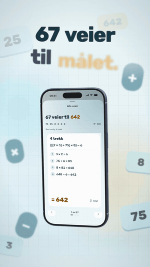

# app-promo

An agent skill for Claude Code (and other skill-aware agents) that makes polished, vertical promo videos for iOS apps:

- **Apple's real 3D iPhone model**, animated in Remotion with three.js
- **Real app UI**: screenshots, cut-outs and screen recordings from the iOS Simulator, never HTML copies
- **Motion graphics** on a beat sheet: kinetic titles, focus zooms, elements lifting out of the screen, varied transitions
- **Generated music and sound effects** from the same timeline, with no licensed audio

The agent interviews you briefly (length, language, how much 3D, ending), reads your app, captures its states in a dedicated simulator, builds the video, checks it frame by frame for consistency, and delivers an MP4 plus a short share text.

## Showcase

<table>
  <tr>
    <td align="center" width="25%"></td>
    <td align="center" width="25%"></td>
    <td align="center" width="25%"></td>
    <td align="center" width="25%"></td>
  </tr>
  <tr>
    <td align="center"><sub><b>Hook and reveal</b><br>the phone builds around the app's own pieces</sub></td>
    <td align="center"><sub><b>Hero moment</b><br>one element lifts out of the screen</sub></td>
    <td align="center"><sub><b>Logo lockup</b><br>built from the app's elements</sub></td>
    <td align="center"><sub><b>Content cards</b><br>the app's real cards beside the phone</sub></td>
  </tr>
</table>

### Raw recording vs. promo

<p align="center">
  
</p>

The same simulator recording, frame for frame. The skill puts it in the real iPhone, moves the camera to what matters and keeps everything on the beat. It works as well for a plain shopping list as for a game. Every video also gets its own generated soundtrack.

## Install

As a skill:

```sh
npx skills add agens-no/app-promo
```

As a Claude Code plugin:

```
/plugin marketplace add agens-no/app-promo
/plugin install app-promo@app-promo
```

Then ask for a promo video for your app, or run `/app-promo`. The skill answers in the language you write in.

## Requirements

- macOS on Apple silicon with Xcode and an iOS Simulator runtime
- [baguette](https://tddworks.github.io/baguette/) (`brew install baguette`) for headless taps, UI trees, screenshots and the device models
- [Blender](https://www.blender.org/) to convert the iPhone model to GLB
- Node 22 and [Remotion](https://www.remotion.dev/)
- Python 3 with Pillow, and ffmpeg

## What's inside

```
skills/app-promo/
  SKILL.md              the workflow the agent follows
  references/           techniques, transitions, sound, recording, consistency checklist
  templates/            reusable Remotion components (Phone, Sprite, Lifted, Title …) and prep tools
  examples/             four complete promos: Unblock (dark, lots of 3D), Talljakt (light, cards and zooms),
                        Quiz (one continuous screen recording, speed ramps, speech bubbles),
                        Kjop (low-key: a plain list, focus zooms and the app's own transitions)
```

The examples come from real apps; their on-screen copy is in Norwegian. Images, fonts, models and recordings are not included, so the examples are reference code rather than projects you can render as-is.

## Licences and assets

- The skill and code are MIT licensed.
- **Remotion** is free for individuals and companies of up to three people; larger companies need a [company licence](https://www.remotion.dev/license).
- **The iPhone model** comes from baguette's bundled Apple device models, and **SF Pro** fonts are Apple's. Neither is included here, and neither should be committed to your project. Using Apple product imagery in marketing is subject to Apple's [marketing guidelines](https://developer.apple.com/app-store/marketing/guidelines/).
- App Store previews must be real recordings without invented effects; this method is aimed at social and private sharing.
