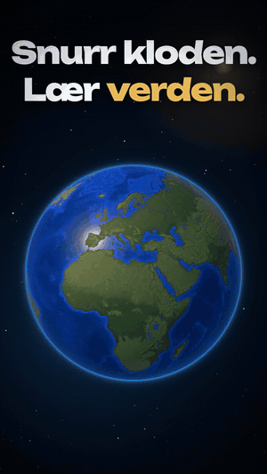
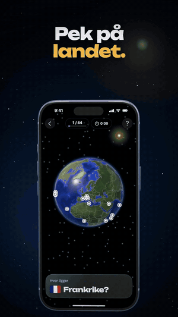

# app-promo

An agent skill for Claude Code (and other skill-aware agents) that makes polished, vertical promo videos for iOS apps:

- **Apple's real 3D iPhone model**, animated in Remotion with three.js
- **Real app UI**: screenshots, cut-outs and screen recordings from the iOS Simulator, never HTML copies
- **Motion graphics** on a beat sheet: kinetic titles, focus zooms, elements lifting out of the screen, varied transitions
- **Generated music and sound effects** from the same timeline, with no licensed audio

The agent interviews you briefly (length, language, how much 3D, ending), reads your app, captures its states in a dedicated simulator, builds the video, checks it frame by frame for consistency, and delivers an MP4 plus a short share text.

## Showcase

Short excerpts from two promos made with the skill (Unblock, a sliding-block puzzle, and Georama, a geography trainer):

| | | |
|:-:|:-:|:-:|
|  |  |  |
| **Hook and reveal:** the app's own pieces, then the phone builds around them | **Hero moment:** one element lifts out of the screen | **Logo lockup** built from the app's elements |
|  |  |  |
| **Match cut:** the globe becomes the screen | **Real recording** with focus zooms on the beat | **Out of the screen:** the content bursts out and settles back |

Every video has its own generated soundtrack, synced to the same beat sheet as the picture.

## Install

As a skill:

```sh
npx skills add agens-no/app-promo
```

As a Claude Code plugin:

```
/plugin marketplace add agens-no/app-promo
/plugin install app-promo@app-promo
```

Then ask for a promo video for your app, or run `/app-promo`. The skill answers in the language you write in.

## Requirements

- macOS on Apple silicon with Xcode and an iOS Simulator runtime
- [baguette](https://tddworks.github.io/baguette/) (`brew install baguette`) for headless taps, UI trees, screenshots and the device models
- [Blender](https://www.blender.org/) to convert the iPhone model to GLB
- Node 22 and [Remotion](https://www.remotion.dev/)
- Python 3 with Pillow, and ffmpeg

## What's inside

```
skills/app-promo/
  SKILL.md              the workflow the agent follows
  references/           techniques, transitions, sound, recording, consistency checklist
  templates/            reusable Remotion components (Phone, Sprite, Lifted, Title …) and prep tools
  examples/             three complete promos: Unblock (dark, lots of 3D), Talljakt (light, cards and zooms),
                        Quiz (one continuous screen recording, speed ramps, speech bubbles)
```

The examples come from real apps; their on-screen copy is in Norwegian. Images, fonts, models and recordings are not included, so the examples are reference code rather than projects you can render as-is.

## Licences and assets

- The skill and code are MIT licensed.
- **Remotion** is free for individuals and companies of up to three people; larger companies need a [company licence](https://www.remotion.dev/license).
- **The iPhone model** comes from baguette's bundled Apple device models, and **SF Pro** fonts are Apple's. Neither is included here, and neither should be committed to your project. Using Apple product imagery in marketing is subject to Apple's [marketing guidelines](https://developer.apple.com/app-store/marketing/guidelines/).
- App Store previews must be real recordings without invented effects; this method is aimed at social and private sharing.
